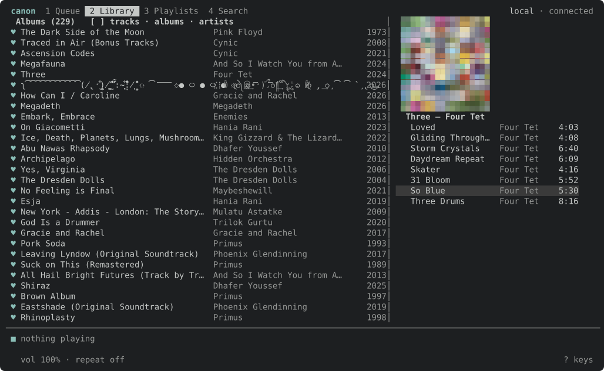

Design decisions 2 and 3, and the mouse (toque yak-f352).

#### 2026-11-21T19:55:26Z

*herd-player · kind: move · from: hairy · to: shaving · thread: ksQQ8ThW0PX0SAyxtEBqIr2N1ZLOAHSsupIBxBCA0aLJyrhJPreUvVwLftHG*

moved: hairy -> shaving

#### 2026-11-21T20:03:07Z

*herd-player*

Claim (herd-player, done in the main thread). Design decisions 2 and 3, and the mouse.

## Keys

- `<` `>` previous / next track. `n` and `p` move off transport.
- `n` `N` next / previous match of the last find. `/` in Library or Playlists is "find in this list": it moves the cursor to the first row whose title or credit contains the text, and `n`/`N` step through the matches. In Search, `/` is a new query, as today. That keeps the design's "`/` filter this list" small: a find, not a filter. A filter would be a new list state, and canon-2b45 is rethinking search vs filters, so the filter waits for that.
- `.` in any view jumps to Now playing: the queue's cursor goes to the playing entry, and the pane goes back to Now playing.
- Exceptions: `d`/`x` (remove from a playlist) stays lowercase as in the queue, since one key, one intent beats the tier rule here. `f` in the outputs picker stays too: modal, and it changes how a speaker is driven, not saved data. The exception notes stop pointing at canon-2feb.

## Mouse

toque `HitMap`. Render records the tab labels, list rows (queue, list, pane), outputs-picker rows and the progress bar.

- Click a row: move the cursor there and give that side the keys. Double-click: `Enter`.
- Click a tab: go there. Click the progress bar: seek.
- Wheel over a list: move by 3. Wheel over the strip: volume.

The live terminal enables mouse capture.

## Evidence

- Tests for each.
- A headless run against a test daemon on 7399, with `click`/`dclick`/`scroll` actions and one rendered frame (`svg`).
- Green bar.

[kp](canon-2feb/kp.log)

#### 2026-11-21T20:09:41Z

*herd-player*

Shipped.

- **Keys:** `<` `>` tracks. `.` from anywhere goes to what is playing. `/` finds in the queue, a list or the pane (title, artist, credit; case-insensitive), and in Search (or with nothing listed) it is a new search. `n` `N` step through the matches, wrapping, in the queue and in lists. A new empty playlist moves from `N` to `C`. The lowercase exceptions are settled and argued in the test.
- **Mouse:** toque `HitMap` (3575652). Render records tabs, queue, list and pane rows, outputs-picker rows, the strip, and per-column progress hits. Click moves and gives that side the keys; a double-click (400 ms, same cell) is `Enter`. Clicking a tab goes there; clicking the bar seeks. The wheel moves 3 rows, and over the strip it is volume. The live terminal enables mouse capture and disables it at exit.
- **toque:** `yak-9d07` made the popup cut long lines instead of collapsing, so the help lines no longer have to be shortened to fit.

Evidence:

- 6 new tests: queue find, list find with wrap and no-match, `.`, click and double-click, tab and wheel, progress seek. canon-tui 67 passed.
- Key reference snapshot reviewed: two columns, `n`/`N` listed.
- Live headless against a test daemon on 7399 with `click 18 0` (Library tab), `dclick 10 6` (an album into the pane, keys there), `/ blue` (cursor to 'So Blue', 6), `.` (pane back to Now playing):  [log](canon-2feb/kp.log).
- Green bar: fmt ok; clippy only the two old firewall.rs warnings; workspace tests ok.

Decision: `/` finds rather than filters. A filter is a new list state, and canon-2b45 is reconsidering search vs filters; a find adds no state and survives whatever that decides. Rejected: a filtered list view now.

Decision: `N` is find-previous, as vim and yaks. "New playlist" moved to `C` (create), beside `c` copy.

Not checked: a real terminal's mouse (only headless events), and text selection with mouse capture on.
