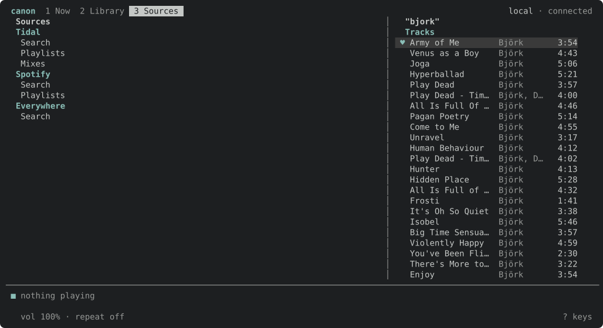

[The third pass](/doks/design/tui-places.md), Three places. Now / Library / Sources replace Queue / Library / Playlists / Search; canon's playlists join Library; Library's kind is a visible row (tracks · albums · artists · playlists); Settings stays on ,. Gathers canon-603e, canon-abaa.

#### 2026-11-27T01:08:26Z

*herd-player · kind: move · from: hairy · to: shaving · thread: ksQQ8ThW0PX0SAyxtEBqIr2N1ZLOAHSsupIBxBCA0aLJyrhJPreUvVwLftHG*

moved: hairy -> shaving

 holding the filter 'opeth'")

[places](canon-44f1/places.log)

#### 2026-11-27T01:37:40Z

*herd-player*

Shipped (coordinator).

- **Places:** `Tab` is Now / Library / Sources (`1`-`3`, `Tab`); Settings stays on `,`.
- **Library:** lists tracks, albums, artists and canon's playlists. Its heading is the kind row with the current one marked and its count. `[` `]` step the four kinds.
- **Library filter:** `/` in Library filters on the server (`Source::Library(kind, query)`, the protocol's existing `query`). It stays across kinds and shows as `holding "…"`; an empty answer takes it off, and it is a history jump.
- **Sources:** one grouped list built by the client (`Entry`: Search per service plus Everywhere, Playlists, Mixes; `sources_rows`), so opening it asks the daemon nothing. `Enter` on a Search asks for the query and opens the results in the pane; on Playlists or Mixes it opens that listing in the pane. History re-builds Sources rather than asking for it.
- **Gone:** `Shelf`, the Playlists and Search tabs, and `Item::item_ref` panicking (it returns `Option` now, `None` for an Entry).
- **Merges:** the target picker is Library's playlists, and starting one is a jump.

Evidence:

- canon-tui 69 passed; 9 snapshots reviewed one by one (tab row; Library's kind row; the new Sources frame; search results now in the pane; key reference).
- New tests: `playlists_live_in_library_and_services_listings_in_sources`, `slash_in_library_filters_on_the_server_and_the_kind_row_says_so`. History tests rewritten for the new walk (search is its own jump, hist=5/0).
- Doc frames regenerated, and the playlists, library and pane frames looked at as PNGs.
- Live headless on 7399: `3 End Enter "bjork" Enter` streamed Everywhere results into the pane ([frame](canon-44f1/places-search.svg)); `2 / opeth Enter [` showed the kind row on playlists holding "opeth" ([frame](canon-44f1/places-library.svg)). [log](canon-44f1/places.log)
- Green bar: fmt ok; clippy only the 2 old firewall.rs warnings; workspace tests ok; build ok.

Decision: the Sources list is built by the client, not fetched. Its entries are fixed per service and the daemon has no op for them. Rejected: a protocol op listing sources (nothing to say yet that `services` doesn't).

Decision: Library's filter persists across kind switches. Rejected: clearing it on `[` `]` ("albums holding opeth" is as useful as tracks).

Decision: `Item::item_ref` returns `Option`. Rejected: keeping the panic and guarding Entry at every caller.

Bug found and fixed on the way: going back into Sources sent `Services` as if it were a page request; `reopen` now rebuilds it.

#### 2026-11-27T01:40:43Z

*herd-player · kind: move · from: shaving · to: shorn · thread: ksQQ8ThW0PX0SAyxtEBqIr2N1ZLOAHSsupIBxBCA0aLJyrhJPreUvVwLftHG*

moved: shaving -> shorn
