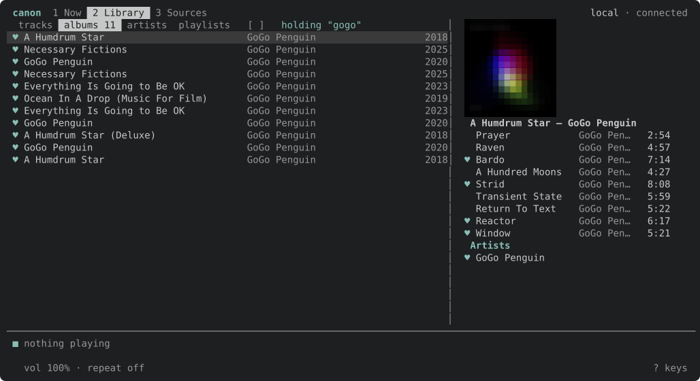

[The third pass](/doks/design/tui-places.md), Three places (Sources) and One protocol. The grouped Sources list; search everywhere streamed per service; Library's / as a server filter. Gathers canon-2b45.

#### 2026-11-27T03:20:34Z

*herd-player · kind: move · from: hairy · to: shaving · thread: ksQQ8ThW0PX0SAyxtEBqIr2N1ZLOAHSsupIBxBCA0aLJyrhJPreUvVwLftHG*

moved: hairy -> shaving

[s5](canon-4565/s5.log)

#### 2026-11-27T03:23:40Z

*herd-player*

Closed (coordinator) by review: its contents shipped with steps 1 and 2, checked here against the dok.

- **The grouped Sources list:** one list, Tidal (Search, Playlists, Mixes), Spotify (Search, Playlists), Everywhere (Search), built by the client. Shipped in canon-44f1 (a0fc420).
- **Search everywhere streamed per service:** `Search { service: None }`, one partial per service, then the merged final. Shipped in canon-9cc1 (472ab46); the TUI folds partials (`Page::fold_partial`).
- **Library's `/` as a server filter:** `Source::Library(kind, query)`, kept across kinds, `holding "…"` in the kind row. Shipped in canon-44f1.

Evidence, live headless on 7399:

- Everywhere search "bjork" in the pane, and the pane keeping it while the cursor sits on that Search row ([frame](canon-4565/s5-search.svg)).
- Library albums filtered by "gogo" on the server, 11 of 229, the album under the cursor followed in the pane with its artist row ([frame](canon-4565/s5-filter.svg)). [log](canon-4565/s5.log)

Not built, left for the post-pass assessment:

- **Import / Export row:** the dok's Sources table lists import and export; neither has a row. Both are protocol ops (`import`, `export`), reachable from `control` only.
- **Unconnected services:** Sources lists Tidal and Spotify whether or not they are signed in; a row for a signed-out service only errors.
