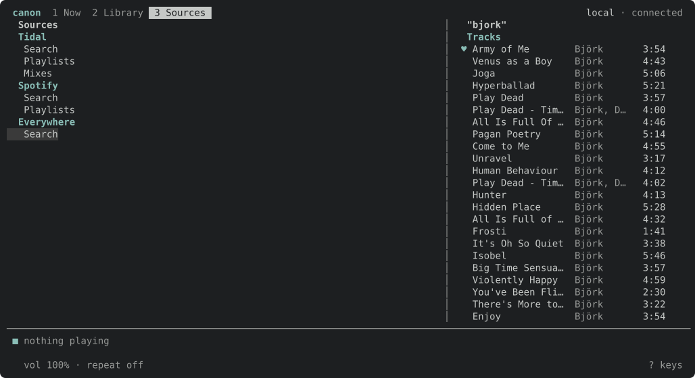

[The third pass](/doks/design/tui-places.md), Three places (Sources) and One protocol. The grouped Sources list; search everywhere streamed per service; Library's / as a server filter. Gathers canon-2b45.

#### 2026-11-27T03:20:34Z

*herd-player · kind: move · from: hairy · to: shaving · thread: ksQQ8ThW0PX0SAyxtEBqIr2N1ZLOAHSsupIBxBCA0aLJyrhJPreUvVwLftHG*

moved: hairy -> shaving

