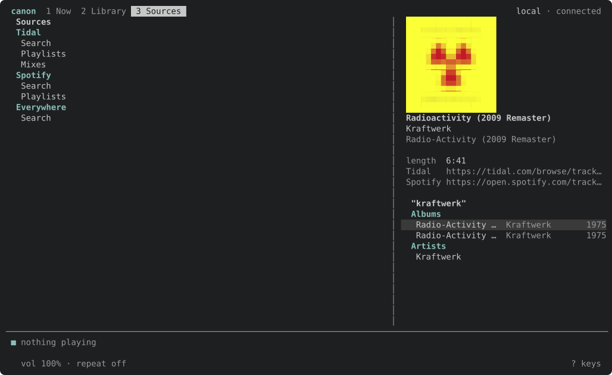
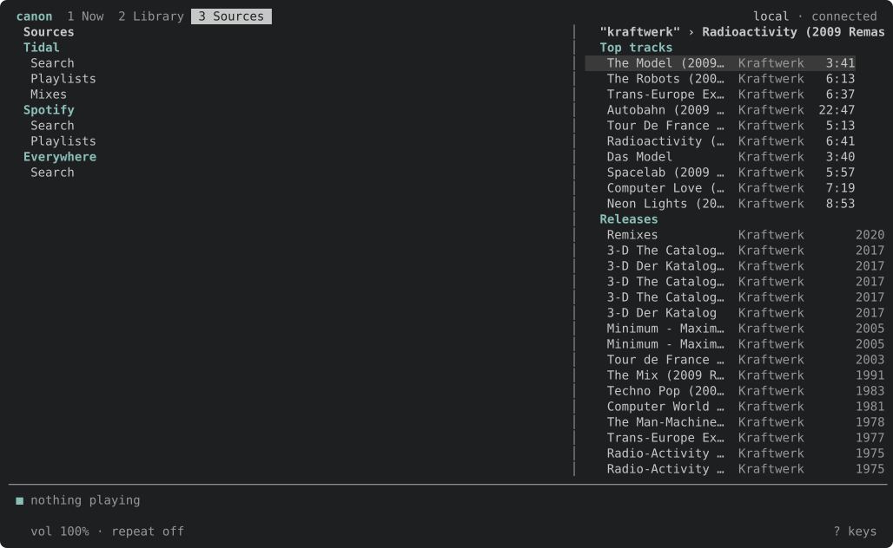

[The third pass](/doks/design/tui-places.md), Every kind has a detail. Names in a detail are links followed through history; something not stored is fetched and stored (not saved); each detail lists its services with copyable links. Gathers canon-5590.

#### 2026-11-27T03:04:57Z

*herd-player · kind: move · from: hairy · to: shaving · thread: ksQQ8ThW0PX0SAyxtEBqIr2N1ZLOAHSsupIBxBCA0aLJyrhJPreUvVwLftHG*

moved: hairy -> shaving

[links](canon-a34e/links.log)

#### 2026-11-27T03:20:16Z

*herd-player*

Shipped (coordinator).

- **Following names:** names in a detail are rows, and `Enter` on one inside the pane opens it as the pane's subject, a history step `o` takes back (that mechanism is step 3's). Track: its albums and artists. Album: its tracklist and, new, its credited artists (`AlbumDetail.artists`, filled by the daemon from the album's artists). Artist: top tracks and releases.
- **Stored on demand:** following something not stored yet fetches and stores it, as the detail ops already did (`Library::album`/`artist`/`track` ingest a service item; stored, not saved).
- **Links:** `y` copies the row's link on a service (the daemon's `links`), and again on the same row the next service's. The notice says which.
- A track's own title no longer repeats in the crumbs above its detail.

Evidence:

- `cargo test -p canon-library an_albums_detail_carries_its_artists`: ok. canon-tui 80 passed (new: `an_albums_artist_is_followed_from_the_pane_and_o_comes_back`, `y_copies_each_services_link_in_turn`).
- Live headless on 7399: Everywhere search "kraftwerk", Enter on a result track showed its detail with Tidal and Spotify links, albums and artist ([frame](canon-a34e/links-track.svg)). End, Enter on Kraftwerk, who is not in the library, fetched and showed top tracks and releases ([frame](canon-a34e/links-artist.svg)). `y` `y` notices: `copied the Tidal link: https://tidal.com/browse/track/3131375`, then `copied the Spotify link: https://open.spotify.com/track/1FL9DHDSED6lxNMDJUJQvB`. `o` went back to the track (hist 4/0 to 3/1). [log](canon-a34e/links.log)
- Green bar: fmt ok; clippy only the 2 old firewall.rs warnings; 31 suites ok; build ok.

Decision: `y` cycles services on repeat rather than asking which. Rejected: a picker (two services today; a picker is a modal for a copy).

Decision: links are copied from the row under the cursor, so they work in any list, not only inside a detail. Rejected: a separate "services" section of link rows in each detail.

Known: the `y` on a track shows the *track's* link even with the cursor... (correct: the selected row's). The crumbs grow long through a chain of follows and get cut at the pane's width.

#### 2026-11-27T03:20:17Z

*herd-player · kind: move · from: shaving · to: shorn · thread: ksQQ8ThW0PX0SAyxtEBqIr2N1ZLOAHSsupIBxBCA0aLJyrhJPreUvVwLftHG*

moved: shaving -> shorn
