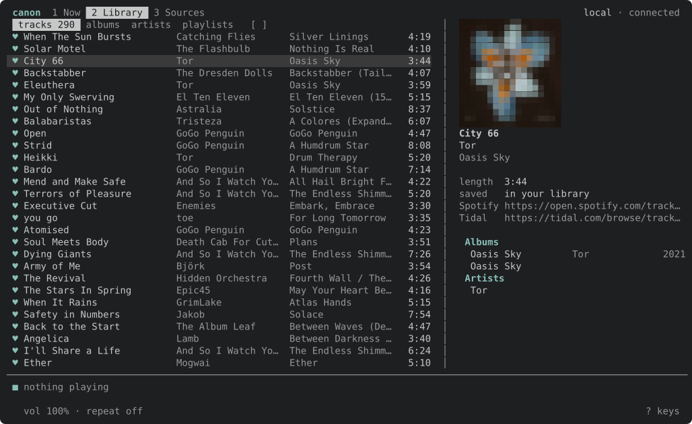
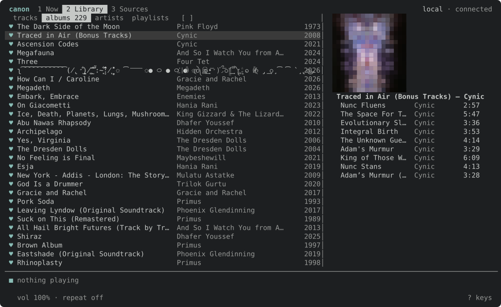
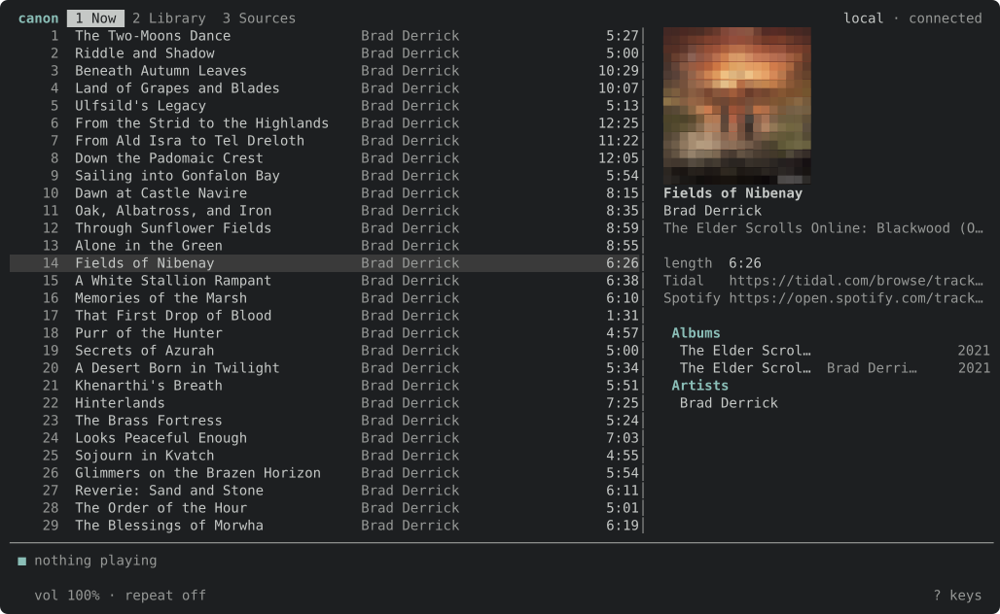
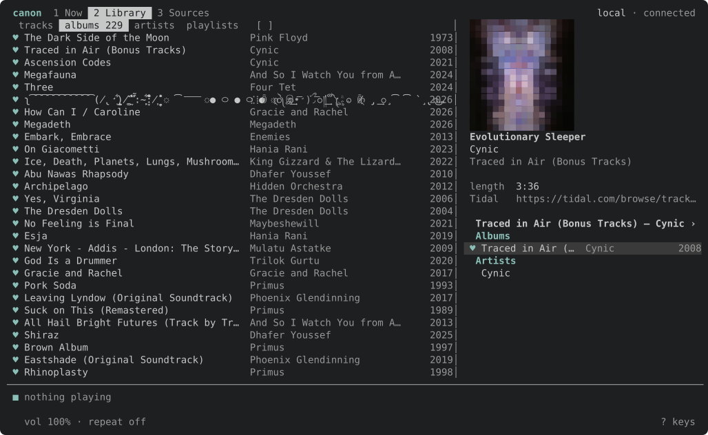

[The third pass](/doks/design/tui-places.md), The pane follows the cursor and Every kind has a detail. A detail per kind (track, album, artist, playlist), fetched after a short settle and cached; Enter goes in, p plays; Now playing is the playing entry's detail. Gathers canon-cb6a.

#### 2026-11-27T02:10:50Z

*herd-player · kind: move · from: hairy · to: shaving · thread: ksQQ8ThW0PX0SAyxtEBqIr2N1ZLOAHSsupIBxBCA0aLJyrhJPreUvVwLftHG*

moved: hairy -> shaving

#### 2026-11-27T02:27:22Z

*herd-player*

Plan (coordinator, doing it in this thread):

- `App::follow_cursor`, run after every key, click and server message: the subject the cursor wants (Library/Sources: the selected item; a track is `Source::Track`; a Search entry is the last search of that service; Now: the queue entry's track, none on the playing entry, so Now playing). Fetched after `FOLLOW_DELAY` (150 ms), fired from `tick`; `Enter` fires it at once.
- Pages the pane lets go of go into a small cache (`follow_cache`, 24), taken back out on return: moving back is instant. Edits that reload playlists drop cached playlist pages.
- `Enter` in the list gives the pane the keys (no jump). In the pane, `Enter` re-subjects it (a jump, as before). `Esc` steps back out.
- `p` plays from here (track: its section from it; album/playlist: all of it; queue: that entry). `P`, `a`, `A` unchanged.
- Track detail: `ClientMessage::Track` (step 1): art, title, credits, duration, services with links; then Albums and Artists as rows.
- `.` jumps to Now, cursor on the playing entry. Queue `Esc` does the same.
- Headless settle waits out a due follow, so frames show the settled pane.

[follow](canon-b3d3/follow.log)

[follow2](canon-b3d3/follow2.log)

#### 2026-11-27T02:49:41Z

*herd-player*

Shipped (coordinator).

- **Follows the cursor:** `App::follow_cursor`, after every key, click and server message, points the pane at the list row's subject: a track (`Source::Track`, the step 1 `Track` op), album, artist, playlist, Sources listing, or a Search entry's last search. In Now, it shows the entry's track, and on the playing entry nothing (the pane's Now playing).
- **Delay:** a new subject is asked for after `FOLLOW_DELAY` (150 ms), fired from `tick`. The live loop wakes for it; headless settle waits it out.
- **Cache:** subjects the pane lets go of are cached (24) and come back instantly. Playlist edits drop cached playlist pages.
- **Keys:** `Enter` in a list gives the pane the keys (asking at once if still waiting); it is no longer a jump. `Enter` in the pane re-subjects it (a jump). `Esc` from the pane hands back to the list and the pane follows again. `p` plays from here: a track with its section, an album/artist/playlist whole, a queue entry by Jump. Queue `Esc` puts the cursor on the playing entry. `.` goes to Now, on the playing entry.
- **Track detail:** cover, title, artists, album, length, saved, each service's link; then Albums and Artists rows.

Evidence:

- canon-tui 78 passed (3 new: `the_pane_follows_the_cursor_once_it_rests_and_comes_back_from_the_cache`, `enter_goes_into_the_pane_at_once_and_p_plays_an_album_whole`, `a_track_shows_its_detail_and_now_playing_is_the_playing_entrys`, the last with a snapshot). History tests updated: going in is no longer a step (walked() at hist=4/0).
- Doc frames regenerated, library frame now shows a track's detail; looked at as PNGs.
- Live headless on 7399: tracks list with City 66's detail and links ([frame](canon-b3d3/follow-track.svg)); albums with the album's tracklist following ([frame](canon-b3d3/follow-album.svg)); queue entry's detail ([frame](canon-b3d3/follow-queue.svg)); Enter into an album, Enter on its track opens the track (hist 2->3), `o` back, Esc to the list ([frame](canon-b3d3/follow-into.svg)). [log](canon-b3d3/follow.log), [log](canon-b3d3/follow2.log)
- Green bar: fmt ok; clippy only the 2 old firewall.rs warnings; 31 suites ok; build ok.
- Not checked: a real terminal's feel of the delay, or holding `j` through a long list against a real daemon.

Decision: 150 ms settle, then ask. Rejected: asking on every move (a request per row held past) and prefetching neighbours (only if latency shows, per the dok).

Decision: only the list side chooses the pane; with the keys in the pane, the pane is the user's. Rejected: the pane's own cursor driving a second pane.

Decision: `Enter` from the list is not a history step, because the pane already showed the subject. Rejected: keeping it a jump (it would push a place that differs only by focus).

Follow-ups: when a subject is opened from the pane, its title shows twice (the track head and the trail's crumbs). Holding `p` close to `P` is a known risk (dok decision 3), to tune with use.

#### 2026-11-27T02:49:43Z

*herd-player · kind: move · from: shaving · to: shorn · thread: ksQQ8ThW0PX0SAyxtEBqIr2N1ZLOAHSsupIBxBCA0aLJyrhJPreUvVwLftHG*

moved: shaving -> shorn
