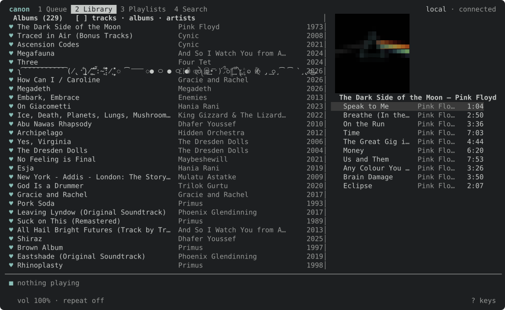
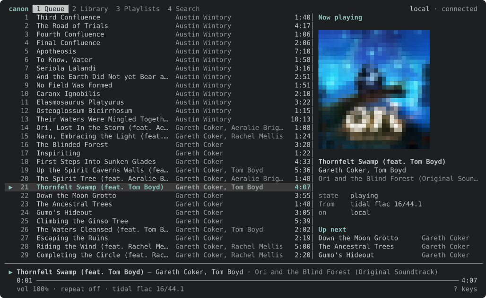

Through the toque image pane (toque yak-d206), from the daemon art endpoint.

#### 2026-11-21T18:28:08Z

*herd-player · kind: move · from: hairy · to: shaving · thread: ksQQ8ThW0PX0SAyxtEBqIr2N1ZLOAHSsupIBxBCA0aLJyrhJPreUvVwLftHG*

moved: hairy -> shaving

")

[art-tui](canon-ed4b/art-tui.log)

#### 2026-11-21T18:42:43Z

*herd-player*

Shipped: album art in the pane.

- **Shape:** `Link::fetch_art` does plain HTTP to the daemon's `/art/<id>?size=320` (same bearer token as the WebSocket) and answers on the link's channel as `Incoming::Art`. The `App` keeps `art: HashMap<EntityId, Art>` (Asked / Ready(toque ImageView) / Missing). `take_art_requests` asks for the playing track's and the open album's art once per session. `awaiting_replies` counts pictures in flight, so headless frames settle with art in them. Both drivers wire it. The live terminal queries the graphics protocol once at startup (`Picker::from_query_stdio`), else half-blocks.
- **Drawing:** Now playing puts a square cover (up to half the pane) under its heading, with the words below. An album in the pane puts its cover (up to a third) over the tracklist. Under 3 rows of room, no art.

Evidence:

- Live headless against a test daemon on 7399 (Joel's 7345 untouched), with frames saved by toque's new `svg` action:  . Text log: [art-tui.log](canon-ed4b/art-tui.log). Real covers: Ori and the Blind Forest, The Dark Side of the Moon.
- Tests (canon-tui 61 passed): asked once and drawn in the pane only when there is one; a failed or unreadable picture is not retried and draws nothing; an album open in the pane wants its cover.
- Doc frames regenerated with a painted cover (queue, pane), looked at as PNGs.
- Green bar: fmt ok; clippy only the two old firewall.rs warnings; workspace tests ok; build ok.

Decision: one requested size (320) rather than sizing to the pane. One cached file per picture on the daemon, and half-blocks need far less anyway. Rejected: per-pane-size requests (more daemon files, refetch on resize).

Decision: the transport strip gets no thumbnail yet. At 3 rows a half-block thumbnail is 6x3 cells of mush; it wants a graphics protocol, so it's left for when that can be checked in a real terminal.

Not seen: a real kitty/sixel/iTerm2 terminal. Only half-blocks have been looked at.

Unrelated, seen in passing: an album with combining-character spam in its title (Megafauna's neighbour) overflows its row on `main` too.
