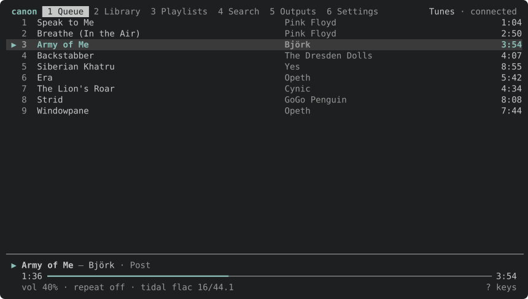
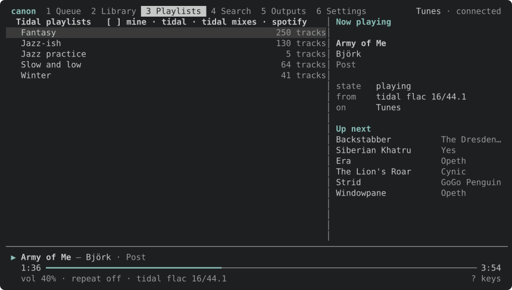
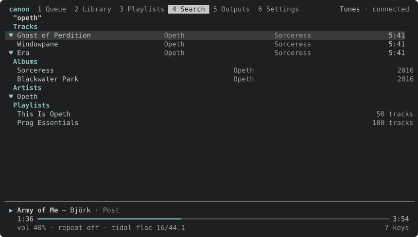
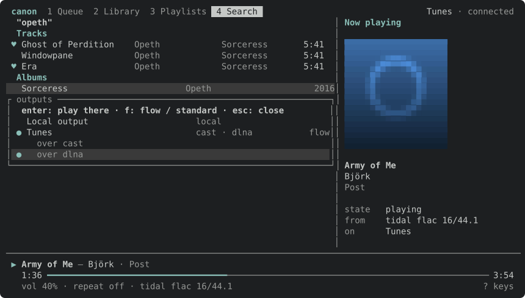
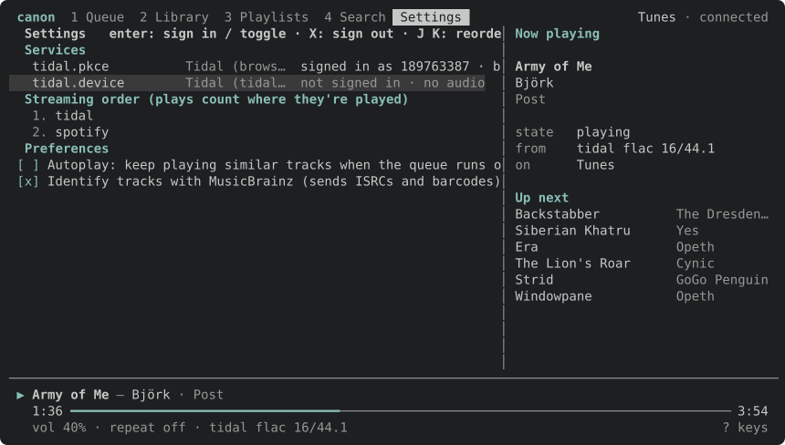

# The TUI

`canon tui` is canon's interactive client: a terminal UI over a running daemon's control plane.
It shows what's playing and the queue, browses the library, playlists and search, and chooses
outputs, signs in to services and changes settings. Everything it does goes through the same
WebSocket API any other client uses, so it can sit on another machine from the daemon.

```sh
canon tui                           # the daemon on this machine (127.0.0.1:7345)
canon tui --connect nas.local:7345  # one elsewhere
```

The frames below are rendered from the real TUI by a test (see [Regenerating the
frames](#regenerating-the-frames)).

## Layout

Four views across the top (`1`–`4`, or `tab` / `shift-tab`), what's playing along the bottom, and
the output and connection at the top right. A terminal at least 100 columns wide also has a pane
on the right of the list, showing what's playing in more room than the strip has: the track, its
artists and album, where the audio comes from and which output it's on, and what plays next.

The row under the cursor sits on a band blended from the terminal's own background and
foreground, which it is asked for at startup, so the band is subtle on a dark theme and a light
one alike. A terminal that doesn't answer (some tmux and ssh setups) falls back to `COLORFGBG`,
then to dark; `CANON_THEME=dark` or `CANON_THEME=light` overrides it. The colours are read
once, so a terminal that changes theme needs `canon tui` restarted.

**Queue** — the queue, with ▶ on the entry playing. Under it: the track, its artists and album, a
progress bar that runs between the daemon's snapshots, the volume, repeat mode, and where the
audio comes from (`tidal flac 16/44.1`).



**Library** — what you've saved, as tracks, albums or artists (`[` `]` to switch). ♥ marks a
saved item; a greyed-out track has nothing bound that can stream. Large libraries load a page at
a time as you scroll.


**Playlists** — canon's own playlists, or a service's: `[` `]` cycles mine → Tidal playlists →
Tidal mixes → Spotify playlists. (Spotify has no mixes, so that pairing isn't offered.) A
service's playlists and mixes are read-only — canon never writes back to one — so they carry no
♥: `c` copies the list under the cursor into a new canon playlist, and `M` merges it into one you
already have.

On canon's own shelf, the playlists are yours to change: `N` makes an empty one, `R` renames the
one under the cursor, `c` duplicates it, and `D` deletes it. Each asks for what it needs first —
a name, typed into the prompt at the top of the page, or (for `D`) a second press to confirm —
and the listing is read again afterwards, so what you changed shows where it is.

Inside one of them, what it holds is yours to change too, with the queue's keys: `d` removes the
track under the cursor and `J` / `K` move it down / up. To put a track in one, find it anywhere —
a search, the library, an album, another playlist — and press `L`: canon's own playlists are
listed to pick from, the same way `M` picks a merge target.



**Search** — results in sections, playlists on the service among them. Albums, artists and
playlists open as pages of their own (`enter`), and `h` / `esc` goes back.



**Outputs** — `ctrl-o`, from any view, opens a picker of every speaker canon has found, with the
protocols it speaks and its mode, its cursor on the one playing now (● marks it). `enter` plays
there and closes the picker; `esc` closes it without changing anything. A speaker that speaks
both Cast and DLNA has a row for each, to pin one.



**Settings** — `,` opens a fifth view, outside the `tab` cycle: each way of connecting to each
service and how it stands, the order services are played from (plays count where they're
played), and preferences. Its name joins the views across the top while it is open.



## Keys

`?` shows the keys for the tab you're on, then the ones that work everywhere. It is generated from
the same table the keys are dispatched by, so it always lists exactly what the keys do, your
overrides included.

**Changing keys.** Put a `keys:` map in `tui.yaml` in canon's config directory
(`~/.config/canon/tui.yaml` on Linux, `~/Library/Application Support/canon/tui.yaml` on macOS),
from a command's name to its keys:

```yaml
keys:
  family: standard          # or vim (the default)
  transport.toggle: ["Enter", "Space"]
  queue.add: A
```

The `standard` family turns off the vim keys (`h` `j` `k` `l`, `g` `G`), leaving the arrows,
`PgUp`/`PgDn` and `Home`/`End`. An override replaces the command's keys wherever it is bound. Keys are
written as `?` shows them (`Ctrl-L`, `S-Tab`, `F3`; quote `]` or `,`). Anything the TUI can't use (an
unknown command, a key it can't read, a key another command already has there) is left out and said
once, at startup. The commands' names are in `crates/canon-tui/src/keys.rs`; they follow the same
scheme as yaks' (`move.down`, `view.next`, `app.quit`).


**Everywhere**

| key | does |
| --- | --- |
| `tab` `1`–`4` | switch view |
| `,` | settings and sign-in |
| `ctrl-o` | choose where to play |
| `/` | search |
| `space` | play / pause |
| `n` `p` | next / previous |
| `←` `→` | seek 10 seconds |
| `+` `-` `m` | volume, mute |
| `s` `r` | shuffle, repeat (off → all → one) |
| `q` | quit |

**Queue**

| key | does |
| --- | --- |
| `j` `k` `↑` `↓` `g` `G` | move |
| `.` | jump to the playing entry |
| `enter` | play this entry |
| `d` | remove it |
| `J` `K` | move it down / up |

**Library, Playlists, Search**

| key | does |
| --- | --- |
| `enter` | on a track, play the list from there; on anything else, open it |
| `h` `esc` | back |
| `a` | add to the end of the queue |
| `A` | play next |
| `P` | play now |
| `*` | save / unsave |
| `c` | copy the list under the cursor into a new playlist |
| `M` | merge it into a playlist: canon's own are listed to pick from; `enter` takes one, `esc` gives up |
| `L` | add the track under the cursor to a playlist, picked the same way |
| `d` | inside one of canon's own playlists, remove the track under the cursor |
| `J` `K` | inside one of canon's own playlists, move the track down / up |
| `R` | rename one of canon's own playlists |
| `D` | delete one of canon's own playlists; press `D` again to confirm, `esc` to call it off |
| `N` | a new empty playlist (Playlists tab) |
| `[` `]` | switch the listing: library tracks / albums / artists, playlists mine / Tidal / Tidal mixes / Spotify |

`c`, `M`, `R` and `D` act on the list the cursor is on — a playlist, a mix, an album — or, when
the cursor is on a track inside one, on the list being shown. Merging only appends what the
target hasn't got already, matched by recording, so re-merging an upstream playlist brings over
just what's new and never removes anything.

`L` is a merge of one track: the playlist takes it only if it hasn't got it already. It has a key
of its own because `M` on a track inside a list already means the whole list.

`R`, `D`, `N`, `d`, `J` and `K` are for canon's own playlists only; a service's are read-only. Copying a
service's list keeps the name it has upstream, but duplicating one of canon's own asks what to
call the copy (two playlists of the same name can't be told apart), suggesting "<name> copy".
`R` and the two copy prompts type into the same box the search uses, pre-filled, so the usual
answer is an edit or just `enter`; `esc` leaves any of them without doing anything.

Deleting is the one thing here that can't be undone — a playlist's recorded versions go with it —
which is why it alone asks twice. Moving the cursor between the two presses arms the new row
rather than deleting it.

Anything that changes canon's playlists — a copy, a merge, an add, a removal or move, a rename,
a delete, a new one — has
the page on screen read again as soon as the daemon has done it, so the listing never needs a
tab re-entry to catch up.

**The outputs picker**

| key | does |
| --- | --- |
| `enter` | play on this output |
| `f` | its mode: flow (gapless, one stream) or standard (one stream per track) |
| `esc` `q` `ctrl-o` | close |

**Settings**

| key | does |
| --- | --- |
| `enter` | sign in; flip a preference |
| `J` `K` | move a service down / up the streaming order |
| `X` | sign out |

Signing in shows what to do: open a URL and paste back the address you land on, or open a link
and enter a code, which the TUI keeps checking until you approve it. The URL is put on the
clipboard as the sign-in opens (by OSC 52, so terminals that refuse it, or tmux without
`set -g set-clipboard on`, won't), and `ctrl-y` copies it again. It is also drawn edge to edge with
nothing beside it, so selecting its rows with the mouse picks up only the URL.

## Driving it from a script

`canon tui --headless` runs the same TUI with no terminal, driven by
[toque](https://github.com/joelgwebber/toque)'s line protocol: one action per line on
stdin, and the frame it leads to, as text, on stdout.

```sh
printf 'key 2\nkey ]\nkey Enter\nkey a\nwait 2000\nquit\n' \
  | canon tui --headless --size 100x30 --connect 127.0.0.1:7345
```

Actions are `key <name>` (`Space`, `Enter`, `Esc`, `Left`, `C-c`, or a character), `type <text>`,
`wait <ms>`, `snapshot`, `resize <w> <h>` and `quit`. Each frame's header says what the TUI
believes (`tab=library depth=2 rows=10 cursor=0 pending=0`), and frames are drawn only once the
replies a key asked for are in, so a script never races the daemon. `--diff` prints only the lines
that changed.

## Regenerating the frames

```sh
cargo test -p canon-tui doc_frames -- --ignored
```

writes `docs/assets/tui-*.svg` from sample data. Run it when the TUI's look changes, and look at
the result: `qlmanage -t -s 1400 -o /tmp docs/assets/tui-queue.svg` makes a PNG on macOS.
