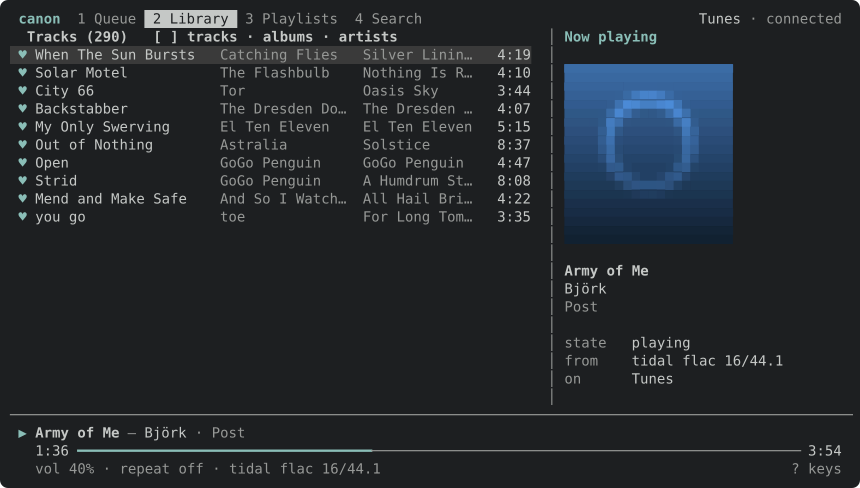
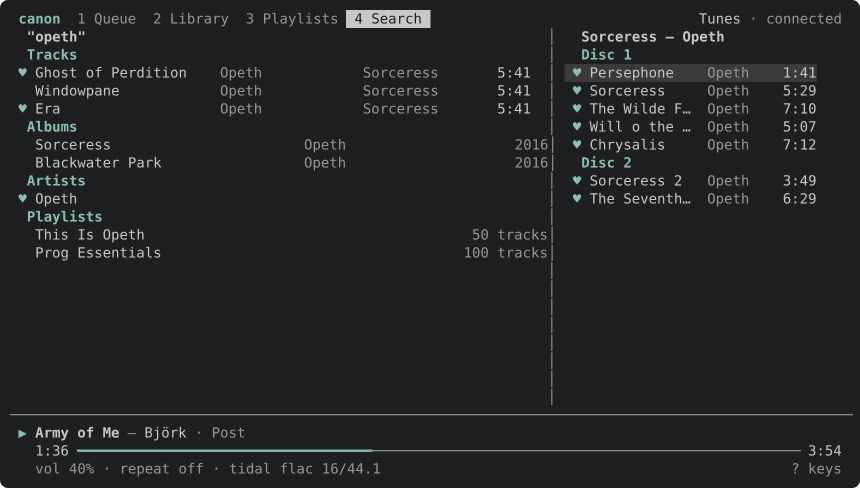
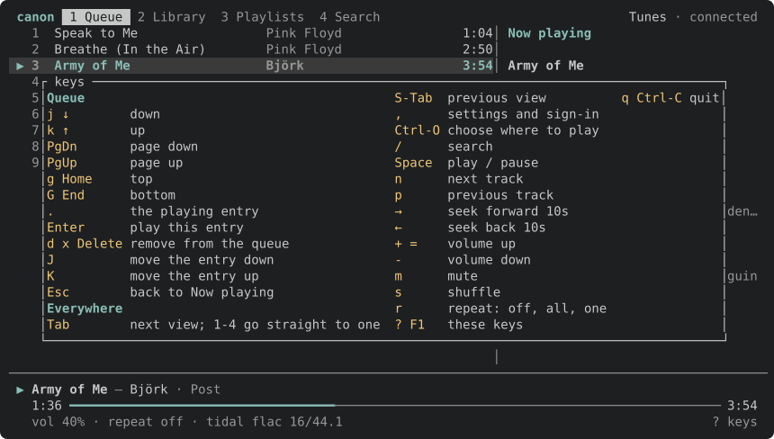

# The TUI

`canon tui` is canon's interactive client: a terminal UI over a running daemon's control plane.
It shows what's playing and the queue, browses the library and what services offer, and chooses
outputs, signs in to services and changes settings. Everything it does goes through the same
WebSocket API any other client uses, so it can sit on another machine from the daemon.

```sh
canon tui                           # the daemon on this machine (127.0.0.1:7345)
canon tui --connect nas.local:7345  # one elsewhere
```

The frames below are rendered from the real TUI by a test (see [Regenerating the
frames](#regenerating-the-frames)).

## Layout

Three places across the top (`1`–`3`, or `tab` / `shift-tab`), what's playing along the bottom, and
the output and connection at the top right. A terminal at least 100 columns wide also has a pane
on the right of the list, showing whatever row the cursor is on (see **The pane** below). On the
queue's playing entry, that is Now playing: the track, its artists and album, where the audio
comes from and which output it's on, and what plays next.

The row under the cursor sits on a band blended from the terminal's own background and
foreground, which it is asked for at startup, so the band is subtle on a dark theme and a light
one alike. A terminal that doesn't answer (some tmux and ssh setups) falls back to `COLORFGBG`,
then to dark; `CANON_THEME=dark` or `CANON_THEME=light` overrides it. The colours are read
once, so a terminal that changes theme needs `canon tui` restarted.

The places are what you are doing, not where the music lives: **Now** is what's playing and
next, **Library** is what's yours, and **Sources** is everything from outside (design:
`doks/design/tui-places.md` in the farm).

**Now** — the queue, with ▶ on the entry playing. Under it: the track, its artists and album, a
progress bar that runs between the daemon's snapshots, the volume, repeat mode, and where the
audio comes from (`tidal flac 16/44.1`).


**Library** — what's yours: tracks, albums, artists and canon's own playlists. The heading is a
row of those kinds with the one showing marked (`[` `]` to switch). `/` filters the whole library,
on the daemon (a find couldn't see the pages not loaded yet); the heading says what it is holding,
and `/` with nothing typed takes the filter off. The filter stays as you switch kind. ♥ marks a
saved item; a greyed-out track has nothing bound that can stream. Large libraries load a page at
a time as you scroll.



**Sources** — one list, grouped by service: each service's Search, Playlists and Mixes, then
Everywhere's Search. The pane shows the row under the cursor; on a Search, `enter` asks what to look for, and
the results open in the pane (Everywhere asks every connected service at once, and the results
arrive service by service, merged as they come). (Spotify has no mixes, so that row isn't
offered.) A service's playlists and mixes are read-only — canon never writes back to one — so they carry no
♥: `c` copies the list under the cursor into a new canon playlist, and `M` merges it into one you
already have.

In Library's playlists, the playlists are yours to change: `C` makes an empty one, `R` renames the
one under the cursor, `c` duplicates it, and `D` deletes it. Each asks for what it needs first —
a name, typed into the prompt at the top of the page, or (for `D`) a second press to confirm —
and the listing is read again afterwards, so what you changed shows where it is.

Inside one of them, what it holds is yours to change too, with the queue's keys: `d` removes the
track under the cursor and `J` / `K` move it down / up. To put a track in one, find it anywhere —
a search, the library, an album, another playlist — and press `L`: canon's own playlists are
listed to pick from, the same way `M` picks a merge target.


A search's results come in sections, playlists on the service among them.

**Album art.** Now playing shows the playing track's cover, and a track's or album's detail in the
pane shows its own, over the details or the tracklist. The daemon fetches, resizes and caches the pictures (`/art/<id>`,
see `docs/arch.md`); the TUI asks for each once per session. A terminal that speaks a graphics
protocol (kitty, sixel, iTerm2) shows the picture itself; any other, and headless frames, show it
as coloured half-block cells.

**The pane follows the cursor.** Whatever row the list's cursor is on, the pane shows its detail:
a track (its cover, artists, album, length, whether it is saved, and its link on each service, then
the albums it is on and its artists), an album's tracklist, an artist's top tracks and releases, a
playlist, a service's playlists or mixes. In the queue, the playing entry's detail is Now playing,
and `.` brings you back to it from anywhere. A detail is asked for once the cursor has rested on a
row for a moment, so holding `j` asks for nothing on the way past, and the last couple of dozen
come back at once when you return to them. Moving the cursor is never a history step.

`enter` gives the pane the keys; the list stays where it was. Inside the pane, `enter` on a row
opens that row as the pane's subject (a history step, which `o` takes back). That is how names are
followed: a track's albums and artists, an album's artists, an artist's releases and top tracks are
rows, and following one you have never seen fetches it from its service and stores it (it is not
saved: `*` saves). `y` copies the row's link on a service; pressed again on the same row, the next
service's. `esc` comes back out a
layer at a time, to what the pane showed before and then to the list, after which the pane follows
the cursor again. `p` plays from here: a track with the rest of its list after it, an album, artist
or playlist whole, a queue entry by jumping to it. On a terminal under 100 columns there's no room
for both, so the pane takes the whole body while it has the keys.

**History.** `o` goes back and `i` forward, in every view and whichever side has the keys. A
jump leaves a place behind: switching place (`tab`, `1`–`3`, `,`), switching Library's kind
(`[` `]`) or filter (`/`), opening a row from inside the pane, or running a search. Moving the cursor, `esc`, switching
focus and the outputs picker are not jumps. `o` restores the whole place: the view, which side had
the keys, the list and the pane's subjects, each read again from the daemon with its cursor where
it was (clamped if the list has shrunk); a subject that can no longer load says so in the notice.
`esc` is separate: it peels layers of the pane, while `o` returns to somewhere you were. A new
jump after `o` drops what `i` would have gone forward to. The last 50 places are kept, and they
are not saved between runs.




**Outputs** — `ctrl-o`, from any view, opens a picker of every speaker canon has found, with the
protocols it speaks and its mode, its cursor on the one playing now (● marks it). `enter` plays
there and closes the picker; `esc` closes it without changing anything. A speaker that speaks
both Cast and DLNA has a row for each, to pin one.


**Settings** — `,` opens a fifth view, outside the `tab` cycle: each way of connecting to each
service and how it stands, the order services are played from (plays count where they're
played), and preferences. Its name joins the views across the top while it is open.


## Keys

`?` shows the keys for the tab you're on, then the ones that work everywhere. It is generated from
the same table the keys are dispatched by, so it always lists exactly what the keys do, your
overrides included.

**Changing keys.** Put a `keys:` map in `tui.yaml` in canon's config directory
(`~/.config/canon/tui.yaml` on Linux, `~/Library/Application Support/canon/tui.yaml` on macOS),
from a command's name to its keys:

```yaml
keys:
  family: standard          # or vim (the default)
  transport.toggle: ["Enter", "Space"]
  queue.add: A
```

The `standard` family turns off the vim keys (`h` `j` `k` `l`, `g` `G`), leaving the arrows,
`PgUp`/`PgDn` and `Home`/`End`. An override replaces the command's keys wherever it is bound. Keys are
written as `?` shows them (`Ctrl-L`, `S-Tab`, `F3`; quote `]` or `,`). Anything the TUI can't use (an
unknown command, a key it can't read, a key another command already has there) is left out and said
once, at startup. The commands' names are in `crates/canon-tui/src/keys.rs`; they follow the same
scheme as yaks' (`move.down`, `view.next`, `app.quit`).



**Everywhere**

| key | does |
| --- | --- |
| `tab` `1`–`3` | switch place: Now, Library, Sources |
| `,` | settings and sign-in |
| `ctrl-o` | choose where to play |
| `/` | find in the list on screen; in Library, filter it; on a Search row or results, search |
| `o` `i` | history back / forward |
| `space` | play / pause |
| `>` `<` | next / previous track |
| `.` | to what is playing: Now, the cursor on the playing entry, the pane on Now playing |
| `←` `→` | seek 10 seconds |
| `+` `-` `m` | volume, mute |
| `s` `r` | shuffle, repeat (off → all → one) |
| `u` | undo the last change to one of canon's playlists (see below) |
| `q` | quit |

**Now**

| key | does |
| --- | --- |
| `j` `k` `↑` `↓` `g` `G` | move |
| `enter` | into the pane (the entry's detail) |
| `p` | play this entry |
| `d` | remove it |
| `J` `K` | move it down / up |
| `n` `N` | next / previous match of the last `/` |
| `esc` | the cursor back to the playing entry |

**Library, Sources, and the pane**

| key | does |
| --- | --- |
| `enter` | into the pane; in the pane, open the row there |
| `p` | play from here: a track and the rest after it, or an album, artist or playlist whole |
| `esc` | back out: the pane's last subject, then the list |
| `a` | add to the end of the queue |
| `A` | play next |
| `P` | play now |
| `*` | save / unsave |
| `y` | copy its link on a service (again: the next service's) |
| `c` | copy the list under the cursor into a new playlist |
| `M` | merge it into a playlist: canon's own are listed to pick from; `enter` takes one, `esc` gives up |
| `L` | add the track under the cursor to a playlist, picked the same way |
| `d` | inside one of canon's own playlists, remove the track under the cursor |
| `J` `K` | inside one of canon's own playlists, move the track down / up |
| `R` | rename one of canon's own playlists |
| `D` | delete one of canon's own playlists; press `D` again to confirm, `esc` to call it off |
| `C` | a new empty playlist (Library's playlists) |
| `n` `N` | next / previous match of the last `/` |
| `[` `]` | Library's kind: tracks / albums / artists / playlists |

**Finding.** `/` in the queue, a list or the pane asks for some text and moves the cursor to the
first row whose title, artist or credit holds it (case doesn't matter); `n` and `N` go to the next
and previous match, round the end. It finds, it doesn't filter: the list stays whole. In Library, `/` filters instead; on a Search row or in search results,
`/` is a new search.

**The mouse.** Click a row to move there (and give that side the keys), click it again quickly to
`enter` it; click a tab to go there, or the progress bar to seek. The wheel moves a list three rows,
and over the transport strip turns the volume. Selecting text in the terminal then wants its own
modifier (Shift in most, Option in iTerm2).

`c`, `M`, `R` and `D` act on the list the cursor is on — a playlist, a mix, an album — or, when
the cursor is on a track inside one, on the list being shown. Merging only appends what the
target hasn't got already, matched by recording, so re-merging an upstream playlist brings over
just what's new and never removes anything.

`L` is a merge of one track: the playlist takes it only if it hasn't got it already. It has a key
of its own because `M` on a track inside a list already means the whole list.

`R`, `D`, `C`, `d`, `J` and `K` are for canon's own playlists only; a service's are read-only. Copying a
service's list keeps the name it has upstream, but duplicating one of canon's own asks what to
call the copy (two playlists of the same name can't be told apart), suggesting "<name> copy".
`R` and the two copy prompts type into the same box the search uses, pre-filled, so the usual
answer is an edit or just `enter`; `esc` leaves any of them without doing anything.

**Undo.** `u`, from any view, undoes the last change to one of canon's own playlists made in
this session: a removal, a move, a merge or add, or a rename. It restores the track list the playlist
held before (with the daemon's `PlaylistRestore`, which records the restore as a version of its
own) and says what it undid: `undid: removed "Era" from "Road trip"`. Press it again for the change
before that; the last 20 are kept, and they are forgotten when the TUI closes. With nothing to undo it says
`nothing to undo`. A change that left the playlist as it was (a merge of tracks it already had, a
move onto itself) or that the daemon refused leaves nothing to undo. Out of scope: deleting a
playlist (its history goes with it, and it asks twice), edits to the queue (the queue is the
session's), saves (`*` toggles itself) and redo.

Deleting is the one thing here that can't be undone — a playlist's recorded versions go with it —
which is why it alone asks twice. Moving the cursor between the two presses arms the new row
rather than deleting it.

Anything that changes canon's playlists — a copy, a merge, an add, a removal or move, a rename,
a delete, a new one — has
the page on screen read again as soon as the daemon has done it, so the listing never needs a
tab re-entry to catch up.

**The outputs picker**

| key | does |
| --- | --- |
| `enter` | play on this output |
| `f` | its mode: flow (gapless, one stream) or standard (one stream per track) |
| `esc` `q` `ctrl-o` | close |

**Settings**

| key | does |
| --- | --- |
| `enter` | sign in; flip a preference |
| `J` `K` | move a service down / up the streaming order |
| `X` | sign out |

Signing in shows what to do: open a URL and paste back the address you land on, or open a link
and enter a code, which the TUI keeps checking until you approve it. The URL is put on the
clipboard as the sign-in opens (by OSC 52, so terminals that refuse it, or tmux without
`set -g set-clipboard on`, won't), and `ctrl-y` copies it again. It is also drawn edge to edge with
nothing beside it, so selecting its rows with the mouse picks up only the URL.

## Driving it from a script

`canon tui --headless` runs the same TUI with no terminal, driven by
[toque](https://github.com/joelgwebber/toque)'s line protocol: one action per line on
stdin, and the frame it leads to, as text, on stdout.

```sh
printf 'key 2\nkey ]\nkey Enter\nkey a\nwait 2000\nquit\n' \
  | canon tui --headless --size 100x30 --connect 127.0.0.1:7345
```

Actions are `key <name>` (`Space`, `Enter`, `Esc`, `Left`, `C-c`, or a character), `type <text>`,
`click <col> <row>`, `dclick <col> <row>`, `scroll up|down <col> <row>`,
`wait <ms>`, `snapshot`, `resize <w> <h>`, `svg <path>` (write the frame, with colour, to a file)
and `quit`. Each frame's header says what the TUI
believes (`tab=library focus=pane pane=1 rows=10 cursor=0 hist=2/0 pending=0`), and frames are drawn
only once the replies a key asked for are in, so a script never races the daemon. `--diff` prints only the lines
that changed.

A change to what the TUI draws gets one rendered frame in its yak, beside the text log: end the
script at the state the change is about with `svg target/<name>.svg`, then `yaks attach <id>
target/<name>.svg` (`yaks render <svg> -o <png>` makes a PNG to look at).

## Regenerating the frames

```sh
cargo test -p canon-tui doc_frames -- --ignored
```

writes `docs/assets/tui-*.svg` from sample data. Run it when the TUI's look changes, and look at
the result: `qlmanage -t -s 1400 -o /tmp docs/assets/tui-queue.svg` makes a PNG on macOS.
