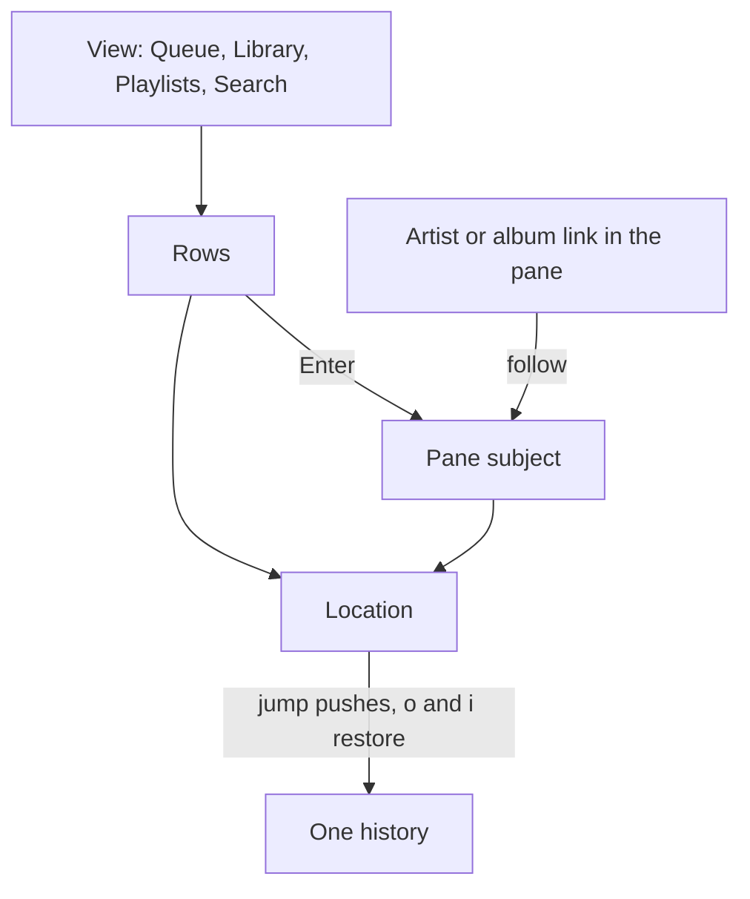

# The canon TUI, second pass: a player

Status: agreed with Joel, 2026-11-21 (decisions below), and shipped (all six phases). Tracked by [canon-686c](/canon/yaks/canon-686c.md).

> **Superseded in part** by [the third pass](/doks/design/tui-places.md): its three places (Now, Library, Sources) replace the views table below, and its pane follows the cursor, replacing "`Enter` shows its subject" and decision 5. Keys, history, art, theme and the outputs picker stand.

The first TUI ([canon-3db9](/canon/yaks/canon-3db9.md)) proved the plumbing: a no-I/O `App`, a pure `render`, a headless toque driver that settles on replies. Its *shape* was a first pass: six tabs, a page stack per tab, a hand-written key `match`, a hand-kept help table, and three lines of now-playing at the bottom. This dok is the shape of the next one.

It borrows the model the yaks TUI arrived at after several rewrites (yaks' `doks/design/tui-model.md` and `doks/design/tui-keys.md`), and takes the reusable parts (theme surfaces, the command table, the image pane) from toque, where they are being extracted for both projects.

## Goals

- **A player first.** What is playing, what is next, and the transport are always in view and always one key away, whatever you are browsing.
- **Browse without losing your place.** Track → artist → album → similar artist is a trail you can walk back (`o`) and forward (`i`).
- **Art where there is room.** Album art in the pane and the transport strip, by the terminal's graphics protocol when it has one, half-blocks otherwise (so headless frames show it too).
- **One key, one meaning,** with help generated from the same table that dispatches, and the same rules and help surfaces as yaks.
- **Readable on any theme,** dark or light: no fixed greys.

Non-goals for this pass: lyrics, visualizers, multi-player control in one screen (`--player` stays a startup choice).

## The model

Four ideas, the same four yaks uses:

- **Row:** one entry in a list: a track, an album, an artist, a playlist (canon's or a service's), a mix, a queue entry, an output.
- **View:** a named list of rows: where they come from, plus a sort and a filter. The tabs are views.
- **Pane:** the right side. It shows one **subject**: an album, an artist, a playlist, or *Now playing*. The subject's kind picks the renderer.
- **Location:** the view, its cursor and scroll, the focus, and the pane's subject. History is one stack of locations.



### Views

| View | Rows | Notes |
|---|---|---|
| Queue | queue entries | `▶` on the playing entry; the default view |
| Library | saved tracks, albums, artists | `[` `]` switch kind, as today |
| Playlists | canon's, then each service's playlists and mixes | `[` `]` switch shelf, as today |
| Search | results in sections | the catalog search; the query is part of the location |

Outputs and Settings stop being peers of the queue. Outputs becomes a **picker** (an overlay listing every speaker, pick one, done): choosing where to play is a momentary act, not a place you browse. Settings and sign-in become a fifth view, reached by key rather than by `Tab` cycling (decision 4): services and preferences are rows like any other.

### The pane and its subjects

- **Now playing** is the pane's resting subject: large art, title, artists and album as links, the source and format, the output, and the next few entries. With nothing playing it says so.
- **Album:** art, credit, year, the tracklist (the cursor can move in it; `Enter` plays from there).
- **Artist:** top tracks, albums, and (when the service has it) similar artists.
- **Playlist / mix:** its tracks.

`Enter` on a list row shows its subject; following a link in the pane (an artist under a track, an album) shows that subject without moving the list, as in yaks (its decision 5). `Esc` peels: the pane's focus, then the pane back to Now playing.

Today's page stack (an album "pushed" over the Library list) goes: an opened album is a pane subject, so the Library list stays beside it.

### One history

Jumps push a location; movement doesn't. A jump is following a link, a view switch, or opening a subject. `o` goes back, `i` forward, in every view and focus. Not persisted.

## Layout

Wide (≥ 100 columns), the list and the pane side by side, the transport strip under both:

```text
 canon  Queue  Library  Playlists  Search                      Tunes · cast · connected
┌───────────────────────────────────────────┐┌──────────────────────────────────────────┐
│   1  Sorceress            Opeth      5:29 ││ ▓▓▓▓▓▓▓▓▓▓▓▓   Will o the Wisp           │
│   2  The Wilde Flowers    Opeth      7:10 ││ ▓▓  art   ▓▓   Opeth                     │
│ ▶ 3  Will o the Wisp      Opeth      5:07 ││ ▓▓▓▓▓▓▓▓▓▓▓▓   Sorceress · 2016          │
│   4  Chrysalis            Opeth      7:12 ││                tidal flac 16/44.1        │
│   5  Era                  Opeth      5:42 ││ Up next                                  │
│                                           ││   Chrysalis · Era                        │
└───────────────────────────────────────────┘└──────────────────────────────────────────┘
 ▓▓ ▶ Will o the Wisp — Opeth                                     vol ▮▮▮▮▯▯▯▯ 40%  ⟳ off
 ▓▓   1:23 ━━━━━━━━━━━━━━━━━━━━━──────────────────────────────────────────── 5:07
 ? keys   space play   < > prev/next   ←→ seek   o/i back/fwd
```

Narrow, the pane takes the whole body when it has focus and the list when it doesn't (`Enter` in, `Esc` out). Short (under ~20 rows), the strip drops to two lines and the art to none. The breakpoints are guesses to tune against real frames.

The **transport strip** is always there: a thumbnail when there is room, the track, a progress bar, a volume gauge, repeat and shuffle, and the bottom hint line generated from the key table. A lost connection or a notice takes the hint line's place, not the track's.

## Keys

The command table from toque (extracted from yaks' `src/tui/keymap.rs`): every binding is a row naming a command (`transport.toggle`, `queue.remove`, `nav.back`), its context, its keys, a help line and a hint label. Dispatch, the `?` popup, the full reference, the bottom hint and `docs/tui.md`'s tables all come from it. User overrides by command name, and the vim/standard family, come with it.

The rules are yaks':

- **Case is a tier.** Lowercase looks, moves and plays; Shift changes something that persists (a playlist, the library, a setting); Ctrl is the app. Adding (`a` enqueue, `*` save) stays lowercase, as yaks' `c`/`*` do.
- **One key, one intent** everywhere; only the target changes with focus.
- **Enter goes in, Esc comes out;** `h`/`l` never move between list and pane.
- **Destructive means confirmed** (delete a playlist: as today, twice).

A first table, to argue over:

| Keys | Command | Today |
|---|---|---|
| `Space` | play / pause | same |
| `>` `<` | next / previous track | `n` `p` |
| `←` `→` | seek 10 s | same |
| `+` `-` `m` | volume, mute | same |
| `s` `r` | shuffle, repeat | same |
| `Tab` `S-Tab` | next / previous view | same; `1`–`4` jump |
| `Enter` | show the row's subject; on a track, play from here | open / play |
| `a` `A` `P` | enqueue at end / next / now | same |
| `*` | save / unsave | same |
| `o` `i` | history back / forward | none |
| `/` | filter this list; in Search, a new query | always the Search tab |
| `n` `N` | next / previous match | none |
| `.` | jump to the playing entry, and show Now playing | queue only |
| `Ctrl-O` | the output picker | Outputs tab |
| `J` `K` `D` `R` `N` `M` `L` `c` | playlist and queue edits | same |
| `?` `F1` | keys for here | same |
| `q` `Ctrl-C` | quit | same |

## Mouse

Through a hit map recorded during render, as yaks does: click a row to move there, double-click to `Enter`; click the progress bar to seek; wheel over the volume gauge to change volume; click a tab.

## Theme

Toque's surfaces: the selection band blended from the terminal's own background and foreground (OSC 10/11, then `COLORFGBG`, then dark), replacing today's `Indexed(238)`, which is a black slab on a light theme. Foregrounds stay the 16 ANSI colours, named by role.

## Decisions

Agreed with Joel on 2026-11-21:

1. **The daemon owns album art:** it fetches, caches and resizes it and serves it to clients over the control plane's HTTP side; clients cache by URL and never reach a CDN. A remote client may not be able to, and one cache serves every client.
2. **Tracks on `<` `>`; `n`/`N` find,** matching yaks. Not slavishly vim: expect to tweak.
3. **Shuffle stays on `s`.**
4. **Settings and sign-in are a fifth view,** not an overlay: fewer fundamental constructs.
5. **Selecting a queue entry leaves Now playing in the pane;** `Enter` plays the entry, and a separate key shows its album.
6. **Outputs are a picker overlay on `Ctrl-O`,** to start with.

Still to tune against real frames: the breakpoints and the narrow layout (80×24, 120×40, a phone-sized ssh session).

## Phases

Each ships on its own; the headless frames and `docs/tui.md` move with each.

1. **On toque's theme surfaces.** No layout change; the band follows the terminal.
2. **On toque's command table.** No key changes; help and hint become generated.
3. **List and pane, Now playing as the resting subject;** outputs become a picker; page stacks become subjects.
4. **One history** (`o`/`i`).
5. **Art:** the daemon's art endpoint and cache, then art in the pane and strip.
6. **The key pass** (decisions 2 and 3) and mouse.
